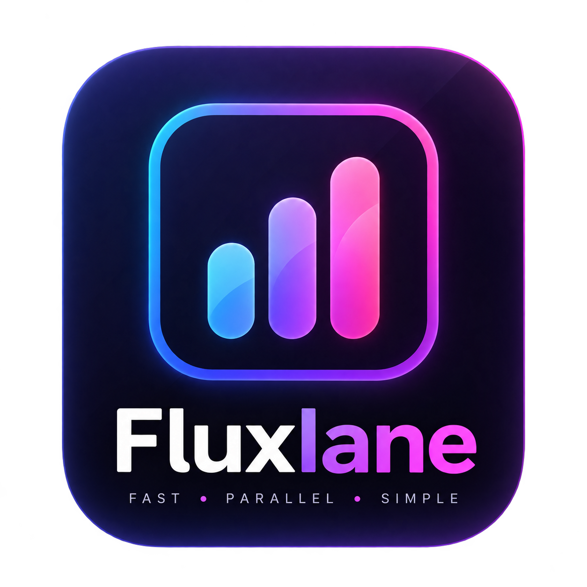

<p align="center">
  
</p>

<h1 align="center">Fluxlane</h1>

<p align="center">
  🚀 Fast · 🔀 Parallel · ✨ Simple
</p>

<p align="center">
  A modern Electron download manager that accelerates downloads by splitting files into chunks and pulling them through multiple network interfaces at the same time.
</p>

<p align="center">
  <a href="https://github.com/RensithUdara/Fluxlane-Application">Repository</a>
  ·
  <a href="#-getting-started">Getting Started</a>
  ·
  <a href="#-features">Features</a>
  ·
  <a href="#-license">License</a>
</p>

---

## ✨ What Is Fluxlane?

Fluxlane is a desktop download manager built for people who want to use more than one active connection at once.

If your Mac has Wi-Fi, Ethernet, and a tethered phone connection, Fluxlane can split a file into byte ranges and download different chunks through different interfaces. Faster connections automatically take more work, slower connections take less, and the final file is reassembled when every chunk is complete.

> Fluxlane can only route traffic through network interfaces that macOS can see.

---

## 🚀 Features

- ⚡ **Parallel multi-interface downloads** using HTTP range requests.
- 🔀 **Dynamic work queue** so faster networks automatically download more chunks.
- 📡 **Network interface detection** for Wi-Fi, Ethernet, bridges, and tethered devices.
- 🎛️ **Selectable networks** with quick actions like Select All, Fastest Only, and Auto Tune.
- 🎨 **Custom network colors and names** for cleaner interface tracking.
- 📊 **Live throughput telemetry** with per-network contribution details.
- 🧩 **Chunk progress grid** showing exactly which network delivered each chunk.
- ⏸️ **Pause and resume support** with cached chunk files.
- 🛡️ **Safe resume validation** using `ETag` and `Last-Modified` when available.
- 🔁 **Retry and stall recovery** for failed or silent chunk requests.
- 📋 **Clipboard paste and recent URL history** for faster setup.
- 💾 **Destination folder picker** with quick reset to Downloads.
- 🌙 **Light/dark system theme support**.

---

## 🖼️ Preview

Add screenshots or a demo GIF here after publishing your first release.

```text
Paste URL -> Choose networks -> Tune streams -> Start download -> Watch chunks merge
```

---

## 🧠 How It Works

Fluxlane uses three main ideas:

### 1. HTTP Range Requests

Fluxlane probes the URL with a tiny ranged request. If the server supports ranges, the file is divided into chunks.

```http
GET /large-file.iso HTTP/1.1
Host: example.com
Range: bytes=0-8388607
```

Each chunk can be downloaded independently and later joined into the final file.

### 2. Interface-Bound Requests

Node.js can bind an outgoing HTTP or HTTPS request to a local network address:

```js
https.request({
  hostname: 'example.com',
  path: '/large-file.iso',
  localAddress: '192.168.1.40',
  headers: {
    Range: 'bytes=0-8388607'
  }
})
```

Fluxlane uses that behavior to send different chunk workers through different physical interfaces.

### 3. Work Stealing

Chunks are not assigned in fixed equal blocks. Instead, every worker pulls the next pending chunk when it becomes free.

```text
Pending chunks: [01] [02] [03] [04] [05] [06]
                  ↑    ↑    ↑
                Wi-Fi ETH  USB
```

That means a faster interface naturally completes more of the file.

---

## 📦 Requirements

- 🍎 **macOS** for full network interface discovery through `networksetup`.
- 🟢 **Node.js 18+**.
- 📦 **npm 9+**.

> Windows and Linux build scripts exist, but Fluxlane’s multi-interface discovery is currently designed around macOS networking tools.

---

## 🛠️ Getting Started

Clone the repository:

```bash
git clone https://github.com/RensithUdara/Fluxlane-Application.git
cd Fluxlane-Application
```

Install dependencies:

```bash
npm install
```

Run in development mode:

```bash
npm run dev
```

If Electron launches as plain Node in your shell, clear this environment variable first:

```powershell
Remove-Item Env:ELECTRON_RUN_AS_NODE -ErrorAction SilentlyContinue
npm run dev
```

---

## 🧪 Development Scripts

| Command               | Description                            |
| --------------------- | -------------------------------------- |
| `npm run dev`         | Start Electron + Vite development mode |
| `npm run start`       | Preview the built app                  |
| `npm run typecheck`   | Run TypeScript checks                  |
| `npm run lint`        | Run ESLint                             |
| `npm run format`      | Format files with Prettier             |
| `npm run build`       | Typecheck and build app bundles        |
| `npm run build:mac`   | Build a macOS app bundle               |
| `npm run build:win`   | Build a Windows package                |
| `npm run build:linux` | Build Linux packages                   |

---

## 🏗️ Build

Build the app:

```bash
npm run build
```

Build an unpacked app directory:

```bash
npm run build:unpack
```

Build for macOS:

```bash
npm run build:mac
```

The macOS app is generated under:

```text
dist/mac/Fluxlane.app
```

---

## 📁 Project Structure

```text
src/
  main/        Electron main process, downloads, IPC, network detection
  preload/     Safe bridge between renderer and main process
  renderer/    React UI
  shared/      Shared TypeScript types and IPC channel names
resources/     Runtime app assets
build/         Build icons and Electron Builder resources
```

---

## 📱 Android USB Tethering

macOS does not include native RNDIS support for many Android USB tethering setups. If your Android phone does not appear as a network interface, you may need a user-space RNDIS solution such as TetherKit.

Fluxlane can only use a tethered phone after macOS exposes it as a network interface with an IP address.

---

## 🤝 Contributing

Contributions are welcome.

Start here:

- Read [CONTRIBUTING.md](CONTRIBUTING.md).
- Check [CODE_OF_CONDUCT.md](CODE_OF_CONDUCT.md).
- Open an issue before large changes.
- Run `npm run typecheck` before submitting a pull request.

---

## 🛡️ Security

Please do not open public issues for security problems.

Read [SECURITY.md](SECURITY.md) for responsible disclosure instructions.

---

## 🗺️ Roadmap Ideas

- 📥 Download queue with multiple saved transfers.
- 🧾 Download history.
- ✅ Checksums after completion.
- 🌐 Better cross-platform interface discovery.
- 🔔 Native notifications.
- 📈 More detailed network analytics.

---

## 📜 License

Fluxlane is released under the [MIT License](LICENSE).

Copyright © 2026 Rensith Udara.

---

## 🙌 Author

Made by **Rensith Udara**.

GitHub: [RensithUdara](https://github.com/RensithUdara)
